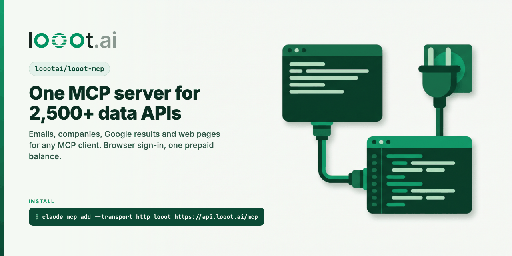

<p align="center"></p>

# looot MCP

[](LICENSE) [](https://docs.looot.ai)

<p>
  <a href="https://cursor.com/en/install-mcp?name=looot&config=eyJ1cmwiOiJodHRwczovL2FwaS5sb29vdC5haS9tY3AifQ=="></a>
  <a href="https://vscode.dev/redirect/mcp/install?name=looot&config=%7B%22type%22%3A%22http%22%2C%22url%22%3A%22https%3A%2F%2Fapi.looot.ai%2Fmcp%22%7D"></a>
  <a href="https://insiders.vscode.dev/redirect/mcp/install?name=looot&config=%7B%22type%22%3A%22http%22%2C%22url%22%3A%22https%3A%2F%2Fapi.looot.ai%2Fmcp%22%7D&quality=insiders"></a>
  <a href="https://replit.com/integrations?mcp=eyJkaXNwbGF5TmFtZSI6Imxvb290IiwiYmFzZVVybCI6Imh0dHBzOi8vYXBpLmxvb290LmFpL21jcCJ9"></a>
</p>

The looot MCP server lets any MCP client find emails, enrich companies, pull Google results and
more: 4,200+ data API operations from 300+ providers on one prepaid balance. It is hosted at
`https://api.looot.ai/mcp` (streamable HTTP) and you sign in with the browser, so no key goes in
any file.

## Quickstart

1. Add the server. In Claude Code:

   ```bash
   claude mcp add --transport http looot https://api.looot.ai/mcp
   ```

   Cursor, VS Code, Codex, Gemini CLI and the rest are under [Install](#install).

2. Run `/mcp`, pick `looot` and choose Authenticate. A browser window opens for sign-in.

3. Ask for a job in plain words, as in the example below.

## Example

Ask your agent:

```text
Use looot to find the work email of Patrick Collison at stripe.com
```

It calls `search` first, which is free. This is the real answer from 2026-11-09, trimmed:

```text
job people.email.find, 29 endpoints
kittai-find-email           Kitt AI        $0.005 per call   works 54% of 12,023 runs, median 4.0 s
companyenrich-people-email  CompanyEnrich  $0.098 per call   no runs yet
fundable-person-email       Fundable       $0.25 per call    no runs yet
```

Then it runs `job:people.email.find` with fallback. looot tries the next provider on a miss and the
result carries the email and the price charged.

## Free to try

Search and inspect are free and need no balance. Paid runs are billed per call at the price
`inspect` shows first, and a failed call costs nothing. A new workspace starts at $0; top up from $5
when you want the first paid result.

## Where it's listed

[](https://clawhub.ai/walidboulanouar/looot)
[](https://skills.sh/loootai/looot-skills)
[](https://www.npmjs.com/package/pi-looot)
[](https://registry.modelcontextprotocol.io/v0/servers?search=ai.looot/looot)
[](https://glama.ai/mcp/connectors/ai.looot/looot)
[](https://lobehub.com/mcp/loootai-looot-mcp)
[](https://mcp.appside.build/mcp-servers/looot/)
[](https://marketplace.dify.ai/plugins/looot/looot)
[](https://marketplace.visualstudio.com/items?itemName=looot.looot)

Also on [cursor.directory](https://cursor.directory/plugins/looot).

## What is in this repo

Most clients connect to the hosted server directly. This repo adds:

- `looot-mcp`, a small npm bin that bridges stdio to the hosted server, for clients that only
  speak stdio. It runs a pinned `mcp-remote` (0.14.3) and adds nothing else.
- `server.json`, the MCP Registry entry (`ai.looot/looot`), remote first.
- `gemini-extension.json` and `GEMINI.md`, the Gemini CLI extension (remote server plus the looot skill as context).
- `llms-install.md`, setup steps an AI agent such as Cline can follow on its own.

See also: [awesome-looot-use-cases](https://github.com/loootai/awesome-looot-use-cases) (copy-paste recipes) and [awesome-gtm](https://github.com/loootai/awesome-gtm) (open-source GTM tools).

> `looot-mcp` is not on npm yet, so the `npx looot-mcp` lines below work only after a release.
> Every remote setup works today.

## Install

Pick your client. Each one connects to the hosted server and opens a browser sign-in the first
time. To use an agent token instead, see [Authentication](#authentication).

### Claude Code

```bash
claude mcp add --transport http looot https://api.looot.ai/mcp
```

Then run `/mcp`, pick `looot` and choose Authenticate.

### Claude (claude.ai and Claude Desktop connector)

Settings, Connectors, Add custom connector. Name `looot`, URL `https://api.looot.ai/mcp`.
Connect, then sign in with your looot account in the browser window that opens.

### Cursor

Click the Install in Cursor button above, or add this to `~/.cursor/mcp.json`:

```json
{
  "mcpServers": {
    "looot": { "url": "https://api.looot.ai/mcp" }
  }
}
```

Also listed on [cursor.directory](https://cursor.directory/plugins/looot).

### VS Code

Click the Install in VS Code button above, or run:

```bash
code --add-mcp '{"name":"looot","type":"http","url":"https://api.looot.ai/mcp"}'
```

or add it to `.vscode/mcp.json`:

```json
{
  "servers": {
    "looot": { "type": "http", "url": "https://api.looot.ai/mcp" }
  }
}
```

### Codex

```bash
codex mcp add looot --url https://api.looot.ai/mcp
codex mcp login looot
```

Or in `~/.codex/config.toml`:

```toml
[mcp_servers.looot]
url = "https://api.looot.ai/mcp"
```

### Gemini CLI

As an extension (adds the server and the looot usage guide):

```bash
gemini extensions install https://github.com/loootai/looot-mcp
```

Or only the server:

```bash
gemini mcp add --transport http looot https://api.looot.ai/mcp
```

Or in `~/.gemini/settings.json` (`httpUrl` is Gemini's key for streamable HTTP):

```json
{
  "mcpServers": {
    "looot": { "httpUrl": "https://api.looot.ai/mcp" }
  }
}
```

Then `/mcp auth looot` inside Gemini CLI.

### ChatGPT (developer mode)

Settings, Apps and Connectors, Advanced settings, turn on Developer mode. Then Create, name
`looot`, MCP server URL `https://api.looot.ai/mcp`, authentication OAuth.

Not yet tested end to end with looot. The public page looot.ai/agents/chatgpt still says this
path is not live.

### Windsurf

In `~/.codeium/windsurf/mcp_config.json`:

```json
{
  "mcpServers": {
    "looot": { "serverUrl": "https://api.looot.ai/mcp" }
  }
}
```

### Any stdio-only client

```json
{
  "mcpServers": {
    "looot": { "command": "npx", "args": ["-y", "looot-mcp@1.0.2"] }
  }
}
```

Until `looot-mcp` is on npm, the same bridge runs straight from mcp-remote:

```json
{
  "mcpServers": {
    "looot": {
      "command": "npx",
      "args": ["-y", "mcp-remote@0.14.3", "https://api.looot.ai/mcp", "--transport", "http-only"]
    }
  }
}
```

## 60-second quickstart

1. Add the server with one of the setups above and sign in.
2. Ask your agent: "Use looot catalog_overview with topic email, then find the cheapest way to
   verify an email." Browsing is free.
3. Top up before the first paid run. The `balance` tool returns the minimum and a payment link;
   new workspaces start at $0 and there is no trial credit.
4. Ask: "Run job:people.email.verify on jane.doe@example.com with fallback." The agent calls
   `run`, and the result carries the price actually charged.

## Tools

The hosted server lists these tools (source: api.looot.ai/llms.txt):

| Tool | What it does | Cost |
| --- | --- | --- |
| `catalog_overview` | categories, platforms and jobs with counts and cheapest prices | free |
| `search_catalog`, `search`, `discover` | find endpoints for a job, ranked by `prefer` | free |
| `discover_smart` | ranks a shortlist against a plain-English use case | small paid AI call |
| `inspect` | input and output schema, price formula, estimated max cost | free |
| `run` | holds the estimated cost, runs, settles; accepts `job:<id>` and `fallback` | paid |
| `runs_get`, `runs_list`, `runs_cancel`, `runs_evidence` | run status, history, cancel, per-attempt receipts | free |
| `balance`, `top_up` | balance and a Stripe payment link | free |
| `my_tools`, `capability_request` | workspace tools, ask for a missing job | free |

## Authentication

Browser sign-in (OAuth) is the default. The server answers an unauthenticated call with
`401` and `WWW-Authenticate: Bearer resource_metadata=...`, and every client above follows that.

For headless agents, create an agent token at looot.ai (Settings, Agent tokens) with at least
`catalog.read`, `runs.read` and `runs.execute`, then export it:

```bash
export LOOOT_TOKEN=cs_ms_...   # shown once, never commit it
```

- `looot-mcp` picks up `LOOOT_TOKEN` and sends it as a bearer header. The token stays out of
  the process list: the bridge passes `Authorization:Bearer ${LOOOT_TOKEN}` and mcp-remote
  expands it from its own environment.
- Claude Code: add `--header "Authorization: Bearer $LOOOT_TOKEN"` to the `claude mcp add` line.
- Codex: add `bearer_token_env_var = "LOOOT_TOKEN"` under `[mcp_servers.looot]`.

## Develop

```bash
npm install --ignore-scripts
npm test            # unit tests, offline
npm run test:live   # free public routes only: /.well-known/mcp.json and the OAuth metadata
npm run scan        # leak scanner, also run by the pre-commit hook
git config core.hooksPath .githooks
```

## Links

- Website: https://looot.ai
- Agent guide: https://api.looot.ai/llms.txt (full: https://api.looot.ai/llms-full.txt)
- API reference: https://docs.looot.ai/reference
- MCP descriptor: https://api.looot.ai/.well-known/mcp.json
- Per-client pages: https://looot.ai/agents.md
- Install guide for agents: [llms-install.md](llms-install.md)

## License

MIT, see [LICENSE](LICENSE). The hosted looot service has its own terms: https://looot.ai/terms
